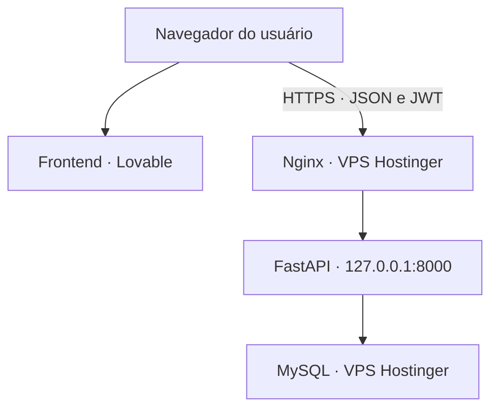

# BeloCupCake — Backend e documentação

Aplicação web responsiva desenvolvida como projeto acadêmico de Engenharia de Software para compra e entrega de cupcakes. A versão demonstrativa possui três perfis: cliente, administrador e entregador. Não realiza cobrança online nem tem finalidade comercial real.

## Acesso à aplicação

| Recurso | Endereço |
| --- | --- |
| Aplicativo para os usuários | https://screenshot-soul-studio-36.lovable.app |
| API HTTPS | https://belocupcake-api.duckdns.org |
| Swagger da API | https://belocupcake-api.duckdns.org/docs |
| Saúde da API | https://belocupcake-api.duckdns.org/health |
| Conexão com o banco | https://belocupcake-api.duckdns.org/health/db |
| Código do frontend | https://github.com/Klaralima/pixel-perfect-replica |

O endereço DuckDNS atende a API. A interface com catálogo, login e pedidos é publicada no Lovable. Não há redirecionamento da raiz da API para a interface previsto no código.

## Situação da versão

Em 08/11/2026, a responsável pelo projeto confirmou o teste manual do fluxo publicado, incluindo cadastro, compra, aceite e conclusão da entrega. As últimas verificações locais registraram 7 testes do backend, 8 testes do frontend, verificação TypeScript e compilação do frontend aprovados. Os testes automatizados usam dependências simuladas e não substituem o teste integrado com MySQL.

## Funcionalidades

| Perfil | Funções implementadas |
| --- | --- |
| Cliente | Cadastro, login, catálogo, detalhe do produto, carrinho, endereço de entrega, criação e consulta dos próprios pedidos |
| Administrador | Cadastro e edição de produtos e estoque, ativação/desativação de produtos, cadastro e listagem de regiões, cadastro de bairros, consulta de pedidos, preparo e cancelamento permitido |
| Entregador | Consulta de entregas disponíveis, aceite por iniciativa própria, consulta das próprias entregas e seus endereços, início da rota e conclusão |

O pagamento é presencial, sem gateway. Taxa e prazo estimado são definidos por região, à qual os bairros são vinculados. O administrador não atribui entregadores.

## Tecnologias e arquitetura

- Backend: Python 3.12, FastAPI, Pydantic, SQLAlchemy, PyMySQL e Uvicorn.
- Banco: MySQL 8, com tabelas InnoDB, índices e restrições de integridade.
- Autenticação: JWT e hash de senhas com Argon2.
- Frontend: React, TypeScript, TanStack Start/Router, TanStack Query, Tailwind CSS e componentes shadcn/ui.
- Hospedagem: frontend no Lovable; API e banco em VPS Hostinger com Ubuntu 24.04.
- Publicação da API: Nginx, HTTPS com certificado Let's Encrypt/Certbot, domínio DuckDNS e serviço systemd.



## Organização do backend

| Caminho | Responsabilidade |
| --- | --- |
| `backend/app/main.py` | Criação da aplicação, CORS, registro de rotas e health checks |
| `backend/app/routers/` | Endpoints HTTP, parâmetros e controle de acesso |
| `backend/app/schemas/` | Validação dos dados recebidos e formato das respostas com Pydantic |
| `backend/app/services/` | Regras de negócio, consultas e transações |
| `backend/app/models/` | Mapeamento ORM das tabelas |
| `backend/app/database.py` | Conexão e sessões SQLAlchemy |
| `backend/app/dependencies.py` | Identificação do usuário e autorização por perfil |
| `backend/sql/` | Scripts de criação do banco, executados em ordem |
| `backend/tests/` | Testes automatizados das consultas e permissões adicionadas para o frontend |

## Instalação local no Windows

Pré-requisitos: Python 3.12, MySQL 8 e Git. Execute no PowerShell:

```powershell
git clone https://github.com/Klaralima/BeloCupCake.git
cd BeloCupCake\backend
python -m venv .venv
.\.venv\Scripts\python.exe -m pip install -r requirements.txt
```

Se o repositório estiver privado, será necessário ter acesso no GitHub. Os comandos usam o Python do ambiente virtual diretamente, sem exigir ativação pelo PowerShell.

### Banco novo

No MySQL Workbench, com uma conta administrativa, crie um banco vazio:

```sql
CREATE DATABASE belocupcake_dev CHARACTER SET utf8mb4 COLLATE utf8mb4_unicode_ci;
```

Abra e execute os arquivos abaixo no Workbench, nesta ordem:

1. `backend/sql/001_criar_cadastros.sql`
2. `backend/sql/002_criar_produtos_pedidos.sql`
3. `backend/sql/003_criar_entrega.sql`

Eles criam as tabelas e não são migrações incrementais. Não os execute novamente no banco de produção já configurado. Crie um usuário de aplicação com SELECT, INSERT, UPDATE e DELETE sobre esse banco; utilize uma conta administrativa separada para criar tabelas.

### Configuração

Crie `backend/.env` localmente, sem versionar o arquivo:

```dotenv
DB_HOST=127.0.0.1
DB_PORT=3306
DB_NAME=belocupcake_dev
DB_USER=belocupcake_app
DB_PASSWORD=SUBSTITUA_PELA_SENHA_LOCAL
JWT_SECRET_KEY=SUBSTITUA_POR_UMA_CHAVE_ALEATORIA_LONGA
```

Gere uma chave JWT aleatória e copie a saída para a variável correspondente:

```powershell
.\.venv\Scripts\python.exe -c "import secrets; print(secrets.token_hex(32))"
```

Inicie a API a partir da pasta `backend`:

```powershell
.\.venv\Scripts\python.exe -m uvicorn app.main:app --reload --host 127.0.0.1 --port 8000
```

Acesse http://127.0.0.1:8000/docs. O modo `--reload` é destinado ao desenvolvimento. Para testar o frontend local, a origem utilizada por ele deve constar na configuração CORS de `app/main.py`.

## Testes

Na pasta `backend`:

```powershell
.\.venv\Scripts\python.exe -m unittest discover -s tests -v
```

A suíte verifica autenticação, autorização, restrição do pedido ao entregador responsável, paginação e precedência da rota `/entregas/minhas`. Ela não altera o banco real. Use também o [roteiro de demonstração](docs/DEMONSTRACAO.md) para validar o fluxo integrado.

## Regras principais

- O cadastro público cria clientes. Perfis administrativos e de entrega são preparados por uma pessoa autorizada, fora do cadastro público.
- O catálogo público exibe produtos ativos e com estoque disponível.
- A API calcula os valores do pedido e valida estoque e região. O navegador não define o preço final.
- Os itens do pedido preservam nome e preço unitário utilizados na compra.
- Pedidos passam por `RECEBIDO → EM_PREPARO → PRONTO → ATRIBUIDA → EM_ROTA → ENTREGUE`.
- O administrador só pode cancelar pedidos em `RECEBIDO`, com devolução do estoque.
- O cliente consulta apenas os próprios pedidos. O entregador consulta o endereço completo apenas das entregas que aceitou.
- A sessão e o carrinho ficam na memória do navegador. Atualizar a página exige novo login e limpa o carrinho.

## Modelo de dados implementado

| Tabela | Finalidade |
| --- | --- |
| `usuario` | Conta, perfil, contato e hash da senha |
| `produto` | Catálogo, preço, estoque e imagem opcional |
| `regiao_entrega` | Taxa fixa e prazo estimado |
| `bairro` | Bairro atendido e vínculo com uma região |
| `pedido` | Cliente, endereço, valores, previsão e estado do pedido |
| `item_pedido` | Produtos, quantidades e valores registrados na compra |
| `entrega` | Pedido aceito, entregador e horários do andamento |

Os scripts SQL são a referência exata para campos, índices e restrições.

## Hospedagem e manutenção

Na VPS configurada, o backend está em `/opt/belocupcake` e é executado pelo serviço `belocupcake`. O Nginx recebe HTTPS e encaminha as chamadas para Uvicorn em `127.0.0.1:8000`. O MySQL permanece na VPS.

Comandos de diagnóstico no terminal SSH:

```bash
systemctl status belocupcake --no-pager -l
journalctl -u belocupcake -n 60 --no-pager
curl -i --max-time 15 https://belocupcake-api.duckdns.org/health/db
```

Após atualizar os arquivos e conferir suas permissões, reinicie com `systemctl restart belocupcake`. Preserve o `.env` e a origem HTTPS do frontend no CORS. Não envie a `.venv` do Windows para o Linux. O frontend precisa ser republicado no Lovable depois da sincronização do código para atualizar o site público.

Mantenha banco e credenciais fora do repositório. Para administração remota do MySQL, utilize túnel SSH. Antes de alterações no banco, faça backup e confira a possibilidade de restauração.

## Limitações e finalidade acadêmica

Sem pagamento online, rastreamento por GPS, upload de imagens, recuperação de senha ou persistência do carrinho. Imagens são indicadas por URL pública; quando ausentes ou indisponíveis, a interface utiliza uma imagem padrão. Não há garantia de operação comercial ou testes de carga realizados. A disponibilidade depende da manutenção das hospedagens.

Para avaliação, compartilhe o link público e conceda acesso aos repositórios privados aos avaliadores. Senhas de demonstração devem ser entregues por canal privado, nunca no README.
